# Architecture

Documento de referencia arquitectónica para todo desarrollo en `card-prototype`. Define qué va en cada carpeta, el grafo real de dependencias entre clases, el detalle archivo por archivo de lo que está hoy en producción y las decisiones técnicas del motor.

**Lectura obligatoria** antes de agregar o refactorizar un archivo en el proyecto.

> **Leyenda de estado:**
> - Sin etiqueta: **Implementado y activo en el código actual.**
> - **`🚧 [FUTURO / PENDIENTE]`**: Planificado en diseño o en transición; aún no implementado o con archivo stub vacío.

---

## Tabla de contenidos

1. [Árbol de directorios](#árbol-de-directorios)
2. [Capas y responsabilidades](#capas-y-responsabilidades)
3. [Grafo de dependencias reales](#grafo-de-dependencias-reales)
4. [Detalle archivo por archivo](#detalle-archivo-por-archivo)
5. [Reglas de oro](#reglas-de-oro)
6. [Patrones de diseño aplicados](#patrones-de-diseño-aplicados)
7. [Decisiones Técnicas](#decisiones-técnicas)
   - 7.1 [¿Por qué CombatResolver es Stateless y no usa Command pattern?](#71-por-qué-combatresolver-es-stateless-y-no-usa-command-pattern)
   - 7.2 [Decisión: Protección de Recursos (Duplicate + Sellado vs Data/Instance)](#72-decisión-protección-de-recursos-duplicate--sellado-vs-datainstance)
   - 7.3 [Decisión: `scenes/` vs `ui/` y Vistas 100% en Código](#73-decisión-scenes-vs-ui-y-vistas-100-en-código)
   - 7.4 [¿Por qué RewardView no genera sus propias recompensas?](#74-por-qué-rewardview-no-genera-sus-propias-recompensas)
   - 7.5 [Decisión: Simulación Predictiva Determinista en `calculate_sequential_preview`](#75-decisión-simulación-predictiva-determinista-en-calculate_sequential_preview)
   - 7.6 [Estándar de Documentación Interna (`##`) y Depuración de Código Obsoleto](#76-estándar-de-documentación-interna--y-depuración-de-código-obsoleto)
   - 7.7 [Decisión: Descomposición de `RunState` en Facade + Stateless Domain Services](#77-decisión-descomposición-de-runstate-en-facade--stateless-domain-services)
   - 7.8 [Decisión: Polimorfismo OCP en `CardEffect` (Eliminación de Type-Switching)](#78-decisión-polimorfismo-ocp-en-cardeffect-eliminación-de-type-switching)
8. [Checklist: agregar X al proyecto](#checklist-agregar-x-al-proyecto)
9. [FAQ](#faq)

---

## Árbol de directorios

```text
card-prototype/
├── README.md
├── .gitignore
├── project.godot
│
├── docs/
│   ├── GDD.md
│   └── ARCHITECTURE.md
│
├── autoload/
│   ├── game_database.gd
│   ├── persistence_manager.gd
│   └── signal_bus.gd
│
├── core/
│   ├── combat/
│   │   ├── combat_resolver.gd
│   │   ├── status_reactions.gd
│   │   ├── temp_stat_manager.gd
│   │   ├── combat_action.gd                    # 🚧 [FUTURO / PENDIENTE - Solo si se agrega Replay/Undo]
│   │   └── actions/                            # 🚧 [FUTURO / PENDIENTE]
│   │
│   ├── deck/
│   │   ├── deck_manager.gd
│   │   └── card_pile.gd
│   │
│   ├── enemies/
│   │   ├── enemy.gd
│   │   ├── enemy_ai.gd
│   │   └── behaviors/
│   │       ├── enemy_behavior.gd
│   │       ├── enemy_context.gd
│   │       ├── enemy_intent.gd
│   │       ├── attack_behavior.gd
│   │       ├── defend_behavior.gd
│   │       └── charge_behavior.gd
│   │
│   ├── run/
│   │   ├── run_director.gd
│   │   ├── run_state.gd
│   │   ├── run_state_machine.gd
│   │   ├── level_progression.gd
│   │   ├── loot_generator.gd
│   │   ├── run_serializer.gd
│   │   └── rarity_system.gd
│   │
│   ├── map/
│   │   ├── floor_generator.gd
│   │   └── room_data.gd
│   │
│   └── constants/
│       └── combat_constants.gd
│
├── systems/                                    # 🚧 [FUTURO / PENDIENTE - Hoy resuelto en core/combat y RunState]
│   ├── statuses/                               # 🚧 [FUTURO / PENDIENTE - Hoy en Enemy + StatusReactions]
│   ├── modifiers/                              # 🚧 [FUTURO / PENDIENTE - Hoy en TempStatManager]
│   └── events/                                 # 🚧 [FUTURO / PENDIENTE - Hoy en SanctuaryModalView + RunState]
│
├── entities/
│   ├── hero/
│   │   ├── hero_data.gd
│   │   ├── abilities/
│   │   │   ├── hero_ability.gd
│   │   │   ├── war_cry_ability.gd
│   │   │   ├── arcane_flow_ability.gd
│   │   │   ├── demon_thrust_ability.gd
│   │   │   └── bloody_slash_ability.gd         # (Define class_name BloodySlashAbility)
│   │   └── data/
│   │       ├── warrior_hero.tres
│   │       ├── magic_hero.tres
│   │       ├── samurai_hero.tres
│   │       ├── assasin_hero.tres
│   │       └── demo_hero.tres
│   │
│   └── enemies/
│       ├── enemy_data.gd
│       └── data/
│           ├── esqueleto.tres
│           └── jefe_basico.tres
│
├── cards/
│   ├── card_data.gd
│   ├── card_instance.gd                        # 🚧 [FUTURO / PENDIENTE - Archivo stub vacío]
│   ├── data/
│   │   ├── corte_rapido.tres
│   │   ├── curacion_basica.tres
│   │   ├── efecto_caotico.tres
│   │   ├── escudo_basico.tres
│   │   ├── estocada.tres
│   │   ├── frasco_veneno_basico.tres
│   │   ├── golpe_congelante.tres
│   │   ├── golpe_fuego.tres
│   │   ├── lanza_rayo.tres
│   │   ├── robo_basico.tres
│   │   ├── sobre_carga.tres
│   │   └── tajo.tres
│   └── effects/
│       ├── card_effect.gd
│       ├── damage_effect.gd
│       ├── defense_effect.gd
│       ├── burn_effect.gd
│       ├── poison_effect.gd
│       ├── freeze_effect.gd
│       ├── shock_effect.gd
│       ├── hemorrhage_effect.gd
│       ├── heal_effect.gd
│       ├── multiply_effect.gd
│       ├── steal_effect.gd
│       └── apply_status_effect.gd
│
├── relics/
│   ├── relic_data.gd
│   ├── relic_instance.gd                       # 🚧 [FUTURO / PENDIENTE]
│   ├── data/
│   │   ├── anillo_brasas.tres
│   │   ├── bolsillo_dimensional.tres
│   │   ├── catalizador_combo.tres
│   │   ├── cenizas_fenix.tres
│   │   ├── colmillo_vibora.tres
│   │   ├── nucleo_sobrecargado.tres
│   │   ├── pata_conejo.tres
│   │   └── trebol_abismo.tres
│   └── effects/
│       ├── relic_effect.gd
│       ├── relic_combo_synergy_effect.gd
│       ├── relic_revive_effect.gd
│       ├── relic_start_status_effect.gd
│       └── relic_stat_bonus_effect.gd
│
├── weapons/
│   ├── weapon_data.gd
│   └── data/
│       ├── arma_basica.tres
│       ├── baculo.tres
│       ├── dagger.tres
│       ├── espadon.tres
│       └── katana_basica.tres
│
├── scenes/
│   ├── battle/
│   │   ├── battle_table.tscn
│   │   ├── battle_table.gd
│   │   └── card_board_controller.gd
│   ├── map/
│   │   └── map_view.gd
│   ├── event/                                  # 🚧 [FUTURO / PENDIENTE]
│   ├── reward/
│   │   └── reward_view.gd
│   ├── shop/
│   │   └── shop_view.gd
│   └── menus/
│       ├── main_menu_view.gd
│       ├── slot_select_view.gd
│       └── hero_select_view.gd
│
├── ui/
│   ├── cards/
│   │   ├── card_ui.tscn
│   │   └── card_ui.gd
│   ├── relics/
│   │   ├── relic_ui.tscn
│   │   └── relic_ui.gd
│   ├── weapons/
│   │   ├── weapon_ui.tscn
│   │   └── weapon_ui.gd
│   ├── battle/
│   │   ├── hud_battle.gd                       # (class_name BattleHUD)
│   │   ├── player_hud.gd
│   │   ├── enemy_hud.gd
│   │   ├── combo_banner.gd
│   │   ├── crit_dice_widget.gd                 # (class_name CritDiceWidget)
│   │   └── pile_inspector.gd
│   ├── inventory/
│   │   └── inventory_modal_view.gd
│   ├── map/
│   │   ├── map_node_view.gd
│   │   ├── sanctuary_modal_view.gd
│   │   └── inspector_modal_view.gd
│   ├── menus/
│   │   └── hero_card_view.gd
│   └── system/
│       ├── pause_menu_view.gd
│       └── debug_overlay.gd
│
├── assets/
│   ├── audio/                                  # music/, sfx/, ui/ (.gitkeep)
│   ├── fonts/                                  # (.gitkeep)
│   └── textures/                               # cards/, heroes/, map/, relics/, ui/ (.gitkeep)
│
├── addons/
│   └── gut/
│
└── test/                                       # 🚧 [FUTURO / PENDIENTE - Carpetas con .gitkeep]
	├── combat/
	├── deck/
	└── run/
```

---

## Capas y responsabilidades

| Capa | Carpeta | Conoce / Depende de | No conoce |
|---|---|---|---|
| **Servicios globales** | `autoload/` | `CombatConstants`, `RunState`, `DeckManager`, `Resource` types | `scenes/`, `ui/` |
| **Lógica de dominio** | `core/` | `entities/`, `cards/`, `relics/`, `weapons/`, `autoload/` | `scenes/`, `ui/` *(excepto `RunDirector`, que actúa como Mediador de vistas)* |
| **Definición de actores** | `entities/` | `cards/`, `relics/`, `weapons/`, `core/enemies/behaviors/`, `CombatConstants` | `scenes/`, `ui/` *(nota: `ArcaneFlowAbility` y `BloodySlashAbility` reciben `table` vía diccionario `context`)* |
| **Datos de cartas** | `cards/` | `RaritySystem`, `WeaponData`, `RunState` (para `combat_rng` en `ApplyStatusEffect`) | `scenes/`, `ui/` |
| **Datos de reliquias** | `relics/` | `RaritySystem`, `CombatConstants`, `Enemy`, `RunState` | `scenes/`, `ui/` |
| **Datos de armas** | `weapons/` | — (100% autónomo) | Todo lo demás |
| **Escenas / Pantallas** | `scenes/` | `core/`, `ui/`, `autoload/`, `entities/`, `cards/`, `relics/`, `weapons/` | — |
| **UI atómica y modales** | `ui/` | Datos inyectados (`CardData`, `RoomData`, `CardPile`, `RunState`, `RaritySystem`) | `scenes/` *(salvo `DebugOverlay`, que es herramienta de QA transversal)* |

---

## Grafo de dependencias reales

```mermaid
flowchart TD
	subgraph Autoloads["autoload/ (Singletons)"]
		SB["SignalBus"]
		GDB["GameDatabase"]
		PM["PersistenceManager"]
	end

	subgraph Scenes["scenes/ (Pantallas y Controladores)"]
		BT["BattleTable (battle_table.tscn + .gd)"]
		CBC["CardBoardController"]
		MV["MapView (100% código)"]
		SV["ShopView (100% código)"]
		RV["RewardView (100% código)"]
		MMV["MainMenuView (100% código)"]
		HSV["HeroSelectView (100% código)"]
		SSV["SlotSelectView (100% código)"]
	end

	subgraph UI["ui/ (Componentes Atómicos y Modales)"]
		BHUD["BattleHUD (PlayerHUD, EnemyHUD, ComboBanner, PileInspector)"]
		CUI["CardUI (card_ui.tscn + .gd)"]
		IMV["InventoryModalView"]
		SMV["SanctuaryModalView"]
		INSP["InspectorModalView"]
		MNV["MapNodeView"]
		HCV["HeroCardView"]
		PMV["PauseMenuView"]
		DBG["DebugOverlay"]
	end

	subgraph Core["core/ (Lógica de Dominio - RefCounted)"]
		RD["RunDirector (Mediator)"]
		RS["RunState"]
		RSM["RunStateMachine (FSM)"]
		CR["CombatResolver (Static)"]
		SR["StatusReactions (Static)"]
		TSM["TempStatManager"]
		DM["DeckManager & CardPile"]
		EN["Enemy & EnemyAI"]
		FG["FloorGenerator & RoomData"]
		RAR["RaritySystem (Static)"]
	end

	subgraph Data["entities/ + cards/ + relics/ + weapons/ (Resources)"]
		RES["HeroData, HeroAbility, EnemyData, EnemyBehavior,\nCardData, CardEffect, RelicData, RelicEffect, WeaponData"]
	end

	BT --> CBC
	BT --> BHUD
	BT --> RD
	BT --> CR
	BT --> DM
	BT --> DBG
	CBC --> CUI
	BHUD --> IMV

	RD --> RSM
	RD --> RS
	RD --> PM
	RD --> MV
	RD --> SV
	RD --> RV
	RD --> MMV
	RD --> SSV
	RD --> PMV

	MV --> MNV
	MV --> SMV
	MV --> INSP
	MV --> IMV
	MMV --> HCV
	RV --> CUI

	RS --> GDB
	RS --> FG
	RS --> RAR
	RS --> TSM
	RS --> EN
	CR --> SR
	EN --> SR
	Core --> RES
	Core --> SB
```



---

## Detalle archivo por archivo

### `autoload/` — Singletons globales

| Archivo | Clase / Tipo | Patrón de Diseño | Responsabilidad real en código |
|---|---|---|---|
| `signal_bus.gd` | `SignalBus` (`Node`) | **Observer / Event Bus (Pub-Sub)** | Declara 5 señales globales desacopladas: `card_played(card_data: CardData)`, `relic_acquired(relic: RelicData)`, `room_entered(room: RoomData)`, `floor_started(floor_number: int)` y `player_leveled_up(new_level: int)`. |
| `game_database.gd` | `GameDatabase` (`Node`) | **Registry / Asset Repository (Singleton)** | Escanea directorios con `ResourceLoader.list_directory()` usando las rutas de `CombatConstants`. Expone `load_all_heroes()` (ordenados por `sort_order`), `load_all_cards()` (recursivo, ignorando `effects/`), `load_all_relics()`, `load_all_enemies()` y `load_all_weapons()`. |
| `persistence_manager.gd` | `PersistenceManager` (`Node`) | **Repository + Atomic Write Persistence** | Administra hasta 3 ranuras (`user://saves/slot_1..3/profile.json` y `run.json`) y el puntero de auto-arranque `user://last_slot.cfg`. Implementa escritura atómica (`_write_atomic`: escribe en `.tmp` y renombra) para evitar corrupción de JSON. |

---

### `core/combat/` — Resolución de combate, reacciones y stats temporales

| Archivo | Clase / Tipo | Patrón de Diseño | Responsabilidad real en código |
|---|---|---|---|
| `combat_resolver.gd` | `CombatResolver` (`RefCounted`) | **Stateless Functional Core + Factory Method** | **100% estático y stateless.** Métodos puros: `create_empty_combo_state()` (**Factory Method** centralizado DRY del diccionario de estado), `calculate_sequential_preview()` (simula el combo preservando el estado de `combat_rng` e incluyendo el multiplicador de daño por nivel sin spoilear críticos), `calculate_final_card_damage()` (verifica `required_weapon_class`, suma `base_damage` y `get_scaling_bonus()` del arma, o aplica penalización de -25% por cada punto de déficit en `STR`/`INT`/`DEX` anulando estados), `_apply_card_effects_to_combo()`, `_is_status_effect()` (polimórfico vía `effect.is_status_effect()`), `process_card_in_combo()`, `finalize_combo()` (aplica reliquias, multiplicador porcentual de nivel `get_level_damage_multiplier()` y la tirada de Golpe Crítico `x1.5` contra `get_crit_chance()`), `tick_enemy_statuses()`, `resolve_enemy_turn()` (inyectando `run.combat_rng` a `try_trigger_shock_stun()`) y `calculate_instant_card()`. |
| `status_reactions.gd` | `StatusReactions` (`RefCounted`) | **Rule Engine / Data-Driven Table Lookup** | Motor estático data-driven (`const REACTIONS`). `check(enemy, incoming)` simula la suma de estados y detecta si se activa **Vaporización** (`burn + freeze` → consume hasta 3 de c/u, 15 daño fijo), **Superconductor** (`freeze + shock` → consume todo, 20 daño fijo) o **Combustión Tóxica** (`burn + poison` → consume todo el veneno, 10 daño fijo). `apply(enemy, reaction)` consume las cargas y aplica el daño. |
| `temp_stat_manager.gd` | `TempStatManager` (`RefCounted`) | **Temporal Modifier Aggregator** | Gestiona buffs/debuffs temporales de estadísticas RPG (`str`, `int`, `dex`) durante un combate. Métodos: `add_mod(stat, amount, turns)`, `tick_turn()`, `get_total_mod(stat)`, `has_mod(stat)`, `clear()`, `get_active_mods_summary()`. |

---

### `core/deck/` — Pilas de cartas y ciclo del mazo

| Archivo | Clase / Tipo | Patrón de Diseño | Responsabilidad real en código |
|---|---|---|---|
| `card_pile.gd` | `CardPile` (`RefCounted`) | **Observable Collection** | Contenedor de `Array[CardData]` con señal `pile_changed(new_count: int)`. Métodos: `add_card()`, `draw_top()`, `shuffle()`, `clear()`, `move_all_to()`, `get_contents_summary()`. |
| `deck_manager.gd` | `DeckManager` (`RefCounted`) | **Facade de Mazo + Prototype con Sellado + Memento** | Administra 3 instancias de `CardPile`: `draw_pile` ("Mazo"), `discard_pile` ("Descarte") y `graveyard_pile` ("Cementerio"). Clona las cartas iniciales (`duplicate()`) sellando la ruta en `resource_name` (**Prototype + Route Sealing**) para serialización (`to_dict()` / `from_dict()`). Expone `get_all_owned_cards(board_cards)` para recuperar el arreglo completo de `CardData` del jugador y `route_played_card()` para enviar cartas `single_use` al Cementerio y el resto a Descarte. |

---

### `core/enemies/` — Lógica de enemigos e IA componible

| Archivo | Clase / Tipo | Patrón de Diseño | Responsabilidad real en código |
|---|---|---|---|
| `enemy.gd` | `Enemy` (`RefCounted`) | **Domain Entity** | Entidad viva del enemigo. Escala `max_hp` (`+25/piso` normal, `x1.45` en variante `is_elite`, `+45/piso` jefe) e `intent_damage` (`+3/piso` normal, `+2 + piso` extra en `is_elite`, `+4/piso` jefe). Gestiona `block`, los 5 estados alterados (`burn`, `poison`, `freeze`, `shock`, `hemorrhage`), reacciones elementales (`apply_statuses()`), estallido dinámico de hemorragia (`apply_hemorrhage_tick()`), parálisis por shock (`try_trigger_shock_stun()`) y congelamiento (`apply_freeze_tick()`). |
| `enemy_ai.gd` | `EnemyAI` (`RefCounted`) | **Chain of Responsibility + Strategy Context** | Orquestador estático `decide_intent(enemy, run, turn_count) -> EnemyIntent`. Itera `enemy.data.intent_pattern` y devuelve el primer `EnemyIntent` no nulo; si no hay ninguno o el array está vacío, hace fallback a un ataque básico con `get_effective_intent_damage()`. |
| `behaviors/enemy_behavior.gd` | `EnemyBehavior` (`Resource`) | **Strategy (Data-Driven Base)** | Clase base abstracta para comportamientos de IA configurables desde el Inspector (`decide(context) -> EnemyIntent`). |
| `behaviors/enemy_context.gd` | `EnemyContext` (`RefCounted`) | **Context Object / DTO** | DTO que encapsula `enemy: Enemy`, `run: RunState` y `turn_count: int`. |
| `behaviors/enemy_intent.gd` | `EnemyIntent` (`RefCounted`) | **Value Object / DTO** | DTO con `enum Type { ATTACK, DEFEND, CHARGE, APPLY_STATUS, NOTHING }`, `damage`, `block`, `status_id`, `status_stacks` y `description`. |
| `behaviors/attack_behavior.gd` | `AttackBehavior` (`EnemyBehavior`) | **Concrete Strategy** | Ataca cada `every_n_turns` turnos sumando el escalado de piso del enemigo. |
| `behaviors/defend_behavior.gd` | `DefendBehavior` (`EnemyBehavior`) | **Concrete Strategy** | Otorga `block` al enemigo cada `every_n_turns` turnos. |
| `behaviors/charge_behavior.gd` | `ChargeBehavior` (`EnemyBehavior`) | **Concrete Strategy (Stateful Phase Cycle)** | Ciclo en fases (`turn_count % every_n_turns`): fase 0 retorna `CHARGE` (0 daño), fase 1 retorna `ATTACK` multiplicado por `bonus_multiplier`, resto retorna `null` para delegar al siguiente behavior. |

---

### `core/run/` — Estado de partida, FSM, Director y Rarezas

| Archivo | Clase / Tipo | Patrón de Diseño | Responsabilidad real en código |
|---|---|---|---|
| `run_state.gd` | `RunState` (`RefCounted`) | **Facade + Domain State Container + Factory Method** | Contenedor de estado vivo e invariantes de equipo de la run (descompuesto bajo SRP): almacena stats del jugador (`player_hp`, `max_player_hp`, `max_energy`, `target_hand_size`, `discards_per_combat`, `player_gold`, `player_luck`, `player_str`, `player_int`, `player_dex`), `player_level`, `player_xp`, `total_xp_earned`, `temp_stats`, `current_weapon`, `inventory_weapons` (mochila hasta 4 armas), `current_ability`, `active_relics`, `floor_data` y `combat_rng`. Delega la progresión de niveles en `LevelProgression`, la generación determinista de recompensas y tienda en `LootGenerator`, y la persistencia JSON en `RunSerializer`. Expone `create_enemy_for_room()` como **Factory Method**. |
| `level_progression.gd` | `LevelProgression` (`RefCounted`) | **Stateless Domain Service (SRP)** | **Servicio estático de dominio (SRP).** Encapsula la curva polinómica de XP requerida (`get_xp_required_for_next_level`), recompensas de XP por tipo de sala (`COMBAT`, `ELITE`, `BOSS`), resolución de subidas de nivel (`apply_xp_gain` con `+5 HP Máx` y `15%` sustain), curva asintótica de Golpe Crítico por Rating (`get_crit_rating`, `get_crit_chance`) y multiplicador porcentual de Daño Global (`get_level_damage_bonus_pct`, `get_level_damage_multiplier`). |
| `loot_generator.gd` | `LootGenerator` (`RefCounted`) | **Stateless Domain Service (SRP)** | **Servicio estático de dominio (SRP).** Sorteo 100% determinista de reliquias (`grant_random_relic`), stock de tienda (`generate_shop_cards`, `generate_shop_relics`) y recompensas post-combate (`generate_combat_rewards` escaladas para `COMBAT`, `ELITE` y `BOSS`). |
| `run_serializer.gd` | `RunSerializer` (`RefCounted`) | **Externalized Serializer / Memento (SRP)** | **Servicio estático de dominio (SRP).** Transforma `RunState` hacia y desde diccionarios JSON (`to_dict`, `from_dict`, `resolve_weapon`, `get_weapon_resource_path`) manteniendo retrocompatibilidad con guardados previos. |
| `run_director.gd` | `RunDirector` (`RefCounted`) | **Mediator (UI & Flow Orchestrator)** | Mediador central. Instancia en código `MapView`, `PauseMenuView`, `MainMenuView`, `HeroSelectView`, `ShopView`, `SlotSelectView` y `RewardView` como hijos de `BattleTable`. Maneja el auto-login con `last_slot.cfg`, la navegación hacia `HeroSelectView`, salas del mapa, compras en tienda, fin de combate, guardado al salir y la captura jerárquica de `KEY_ESCAPE` (`handle_unhandled_key()`: cierra primero cualquier modal superpuesto como `InventoryModalView`, `InspectorModalView` o `PileInspector` antes de abrir `PauseMenuView`). |
| `run_state_machine.gd` | `RunStateMachine` (`RefCounted`) | **Finite State Machine (FSM)** | FSM con `enum State { MENU, MAP, BATTLE, REWARD, EVENT, SHOP, DEAD, VICTORY }`. Valida transiciones en `_is_valid_transition(from, to)` y emite `state_changed(new_state)`. |
| `rarity_system.gd` | `RaritySystem` (`RefCounted`) | **Stateless Probability Engine** | Motor estático de probabilidades con 5 Tiers (`COMMON`, `UNCOMMON`, `RARE`, `EPIC`, `LEGENDARY`). Calcula `fortune` según `floor_number` y `player_luck`, sortea rarezas (`roll_tier`), hace sorteos ponderados genéricos (`roll_weighted`) e interpolación lineal suavizada por suerte (`get_scaled_value_smooth`). |

---

### `core/map/` y `core/constants/`

| Archivo | Clase / Tipo | Patrón de Diseño | Responsabilidad real en código |
|---|---|---|---|
| `room_data.gd` | `RoomData` (`RefCounted`) | **Value / State Node** | Representa una celda de la matriz `8x8` con `enum Type { START, COMBAT, TREASURE, REST, SANCTUARY, BOSS, SHOP, ELITE }`, `grid_pos`, `cleared`, `discovered`, `neighbors: Array[Vector2i]` y caché de tienda (`shop_cards`, `shop_relics`, `shop_initialized`). Provee nombre y color temático según estado (`ÉLITE ⚔️` en naranja cobrizo). |
| `floor_generator.gd` | `FloorGenerator` (`RefCounted`) | **Procedural Builder (Static Graph Generator)** | Generador procedural estático de grafo ortogonal en grilla `8x8` (`BASE_START_ROOMS = 8`). Expande la frontera desde el centro evitando bloques 2x2, conecta vecinos ortogonales y asigna salas especiales en los `dead_ends` ordenados por distancia Manhattan (`BOSS` en el más lejano, `TREASURE`, `REST`, `SHOP`, `SANCTUARY`), además de convertir 1–2 salas de combate a distancia Manhattan $\ge 2$ en encuentros `ELITE`. |
| `combat_constants.gd` | `CombatConstants` (`RefCounted`) | **Static Configuration / Constants Catalog** | Rutas de catálogos, umbrales (`FREEZE_STUN_THRESHOLD = 5`, `HEMORRHAGE_BURST_THRESHOLD = 10`, `SHOCK_STUN_CHANCE_PER_STACK = 0.12`, etc.), constantes de curva de nivel y estadísticas base del jugador (`BASE_HAND_SIZE = 5`, `BASE_MAX_ENERGY = 3`, `MAX_INVENTORY_SIZE = 4`). |

---

### `entities/`, `cards/`, `relics/`, `weapons/` — Recursos de Datos y Estrategias

| Carpeta / Archivo | Clase Base | Patrón de Diseño | Implementaciones Concretas Actuales |
|---|---|---|---|
| `entities/hero/hero_data.gd` | `HeroData` (`Resource`) | **Data Object / Archetype Template** | `warrior_hero.tres` (Guerrero), `magic_hero.tres` (Mago), `samurai_hero.tres` (Samurai), `assasin_hero.tres` (Asesino), `demo_hero.tres` (DEMO). |
| `entities/hero/abilities/` | `HeroAbility` (`Resource`) | **Strategy (Data-Driven Command)** | `WarCryAbility` (`war_cry_ability.gd`), `ArcaneFlowAbility` (`arcane_flow_ability.gd`), `DemonThrustAbility` (`demon_thrust_ability.gd`), `BloodySlashAbility` (`bloody_slash_ability.gd`). |
| `entities/enemies/enemy_data.gd` | `EnemyData` (`Resource`) | **Data Object + Strategy Composition** | `esqueleto.tres` (con `DefendBehavior`), `jefe_basico.tres` (`is_boss = true`). |
| `cards/card_data.gd` | `CardData` (`Resource`) | **Composite Data + Polymorphic Delegation (OCP)** | 12 cartas en `cards/data/`: `corte_rapido`, `curacion_basica`, `efecto_caotico`, `escudo_basico`, `estocada`, `frasco_veneno_basico`, `golpe_congelante`, `golpe_fuego`, `lanza_rayo`, `robo_basico`, `sobre_carga`, `tajo`. Incluye `@export var is_magical: bool`, `@export var artwork: Texture2D` y helpers de presentación que delegan polimórficamente en sus `CardEffect` (`is_magic_card()`, `get_color()`, `get_art_accent_color()`, `get_weapon_icon()`, `get_weapon_tag_text()`, `get_placeholder_emblem()`, `get_rules_text()`, `get_enemy_status_icons()`). |
| `cards/effects/` | `CardEffect` (`Resource`) | **Strategy + Template Method / Polymorphic Hook (OCP)** | Clase base con `@export var is_magical: bool = false` y contrato polimórfico OCP (`is_status_effect()`, `is_offensive()`, `get_status_icon()`, `get_emblem_icon()`). Subclases: `DamageEffect`, `DefenseEffect`, `BurnEffect` (`is_magical = true`), `PoisonEffect`, `FreezeEffect` (`is_magical = true`), `ShockEffect` (`is_magical = true`), `HemorrhageEffect`, `HealEffect`, `MultiplyEffect` (`is_magical = true`), `StealEffect` (instantánea), `ApplyStatusEffect` (`is_magical = true`, fijo o `RANDOM`). |
| `relics/relic_data.gd` | `RelicData` (`Resource`) | **Composite Data + Observer Hook Container** | 8 reliquias en `relics/data/`: `anillo_brasas`, `bolsillo_dimensional`, `catalizador_combo`, `cenizas_fenix`, `colmillo_vibora`, `nucleo_sobrecargado`, `pata_conejo`, `trebol_abismo`. Incluye `@export var artwork: Texture2D`, `@export_multiline var lore: String` y helpers de presentación (`get_effect_summary_text()`, `get_lore_text()`, `get_placeholder_emblem()`). |
| `relics/effects/` | `RelicEffect` (`Resource`) | **Strategy (Lifecycle Hook Callbacks)** | `RelicStatBonusEffect`, `RelicStartStatusEffect`, `RelicComboSynergyEffect`, `RelicReviveEffect`. |
| `weapons/weapon_data.gd` | `WeaponData` (`Resource`) | **Value Resource + Scaling Calculator** | 5 armas en `weapons/data/`: `arma_basica.tres` (Palito), `baculo.tres` (Báculo Básico), `dagger.tres` (Daga), `espadon.tres` (Espadón), `katana_basica.tres` (Katana Básica). Incluye `@export var rarity: RaritySystem.Tier`, `@export var artwork: Texture2D`, `@export_multiline var lore: String` y helpers de presentación (`get_weapon_tag_text()`, `get_stats_and_scaling_text()`, `get_lore_text()`, `get_placeholder_emblem()`). |

---

### `scenes/` y `ui/` — Capa de Presentación

| Archivo | Clase | Tipo de UI | Patrón de Diseño | Responsabilidad |
|---|---|---|---|---|
| `scenes/battle/battle_table.gd` | *(Control)* | `.tscn` + `.gd` | **Facade / Screen Controller (MVC Coordinator)** | Nodo raíz de la escena principal y fachada de combate. Coordina `CardBoardController`, `BattleHUD`, `DeckManager`, `CombatResolver` y `RunDirector`. Verifica letalidad tanto tras ejecutar un combo como tras activar `HeroAbility`. |
| `scenes/battle/card_board_controller.gd` | `CardBoardController` | `RefCounted` | **Sub-Controller / Interaction Presenter** | Administra las listas `hand_cards` y `combo_cards` de nodos `CardUI`, calcula el layout dinámico horizontal, e intercala cartas en vivo durante el drag & drop. |
| `scenes/map/map_view.gd` | `MapView` | 100% código (`Control`) | **Procedural View + Pass-Through State Binding** | Dibuja la grilla 8x8 y sus pasillos (`_draw()`), recibe `setup_floor(run, owned_cards)` directamente sin acoplamiento de 16 parámetros, instancia `MapNodeView` por cada sala descubierta, y aloja `SanctuaryModalView`, `InspectorModalView` e `InventoryModalView`. |
| `scenes/reward/reward_view.gd` | `RewardView` | 100% código (`Control`) | **Passive View / Presenter (Zero Domain Logic)** | Modal post-victoria adaptado al viewport `1152x648` con barra animada de progreso de Nivel/XP e instancias `CardUI` (`180x240`), animaciones estilo Balatro (pop-in con `TRANS_BACK`, flotación senoidal desfasada y hover magnético con inclinación). |
| `scenes/shop/shop_view.gd` | `ShopView` | 100% código (`Control`) | **Transactional View (Metadata-Bound UI)** | Tienda del Bazar: renderiza 3 cartas y 2 reliquias tasadas por `RaritySystem.Tier`, almacenando `meta("price")` y `meta("sold")` en cada botón para validar oro sin parsear texto de UI. |
| `scenes/menus/main_menu_view.gd` | `MainMenuView` | 100% código (`Control`) | **Menu View (Signal Emitter)** | Menú principal enfocado en mostrar el estado del perfil activo ya cargado (nombre, ranura, mejor piso, victorias), mensajes de Game Over y navegación hacia `HeroSelectView` o `SlotSelectView`. |
| `scenes/menus/slot_select_view.gd` | `SlotSelectView` | 100% código (`Control`) | **Slot Manager View** | Gestión de las 3 ranuras de guardado con modal emergente para nombrar nuevo perfil. |
| `scenes/menus/hero_select_view.gd` | `HeroSelectView` | 100% código (`Control`) | **Carousel Selector View** | Pantalla dedicada de preparación de expedición: instancia las tarjetas `HeroCardView`, muestra la ficha técnica del héroe elegido (descripción, arma y habilidad activa) y gestiona el ingreso opcional de semilla (`seed`). |
| `ui/cards/card_ui.gd` | `CardUI` | `.tscn` + `.gd` | **Dual-Mode Autonomous UI Component** | Representación visual responsiva de una carta en 4 bloques (`[Costo] Nombre [Icono Arma]`, recuadro de Arte 2D / emblema, tag `[🏷️ Familia de Arma]`, y caja inferior con descripción centrada + ícono de estado alterado sobre el enemigo abajo a la izquierda). Incluye física de resorte exponencial (`exp(-28 * delta)`), tilt por velocidad horizontal, animación de disolución (`play_consume_animation()`) y modo estático para contenedores (`set_static_display_mode(true)`). |
| `ui/relics/relic_ui.gd` | `RelicUI` | `.tscn` + `.gd` | **Autonomous UI Widget** | Representación visual de una reliquia en 4 bloques (`Nombre + [Rareza]`, Marco/Pedestal central con Sprite 2D o emblema, bloque de `EFECTO` resaltado y bloque de `LORE / HISTORIA` en cursiva BBCode atenuada) con resorte de escala e inclinación en hover. |
| `ui/weapons/weapon_ui.gd` | `WeaponUI` | `.tscn` + `.gd` | **Autonomous UI Widget** | Representación visual e interactiva de un arma en 5 bloques (`Nombre + [Rareza]`, Marco/Pedestal central con Sprite 2D o emblema, píldora `🏷️ Tipo de Arma`, bloque de `ESTADÍSTICAS / ESCALADO` con daño base y efecto pasivo On-Hit, y bloque de `LORE / DESCRIPCIÓN` en cursiva atenuada). Emite `weapon_clicked(weapon)` para equiparla desde el inventario. |
| `ui/battle/hud_battle.gd` | `BattleHUD` | Nodos en `battle_table.tscn` + `.gd` | **Facade de UI de Combate** | Orquesta `PlayerHUD`, `EnemyHUD`, `ComboBanner`, `PileInspector`, `CritDiceWidget`, botones de pilas y el botón lateral de `🎒 INVENTARIO` (`InventoryModalView`). |
| `ui/battle/crit_dice_widget.gd` | `CritDiceWidget` | 100% código (`PanelContainer`) | **Autonomous Animated Dice Component (SRP)** | Componente autónomo del **Dado D100 de Crítico** (`play_roll()`). Presenta en 3 etapas legibles el umbral requerido (`0.55s`), el giro del D100 (`~0.65s`) y el desglose comparativo del resultado y daño final (`2.7s` Normal / `3.2s` Crítico). Soporta **clic para saltar (`_gui_input` + `_wait_or_skip`)** en cualquier etapa sin perder el callback `on_landed`. |
| `ui/battle/player_hud.gd` | `PlayerHUD` | `Panel` | **Autonomous Sub-Presenter** | Renderiza nombre del héroe, Nivel, barra de XP, HP, escudo, arma equipada, energía y suerte. |
| `ui/battle/enemy_hud.gd` | `EnemyHUD` | `Panel` | **Autonomous Sub-Presenter** | Renderiza nombre, HP, bloqueo, intención declarada y cargas de estados alterados (incluyendo `% Stun` de Shock y progreso `X/5` de Freeze). |
| `ui/battle/combo_banner.gd` | `ComboBanner` | `Label` | **Notification Banner Component** | Formatea el diccionario predictivo de `CombatResolver.calculate_sequential_preview()` (incluyendo `🎲 X.X% CRIT (x1.5)`) o muestra alertas de combate (`💥 ¡CRÍTICO x1.5!`, `⬆️ ¡NIVEL X!`). |
| `ui/battle/pile_inspector.gd` | `PileInspector` | `Panel` | **Modal Inspector Component** | Popup que renderiza visualmente las cartas de Mazo, Descarte o Cementerio mediante una grilla de `CardUI` en modo estático con insignia superior `"x1"` / `"xN"` por cantidad de copias. |
| `ui/inventory/inventory_modal_view.gd` | `InventoryModalView` | 100% código (`Control`) | **Master-Detail Split Modal** | **Inventario General unificado** con botón de cierre `✕` arriba a la derecha (y soporte de retroceso con `ESC`) dividido en dos paneles paralelos: a la izquierda `[ ⚔️ ARMAS Y EQUIPO ]` (Arma Equipada arriba + Bolsa de Armas en grilla 2xN de `WeaponUI` interactivas abajo) y a la derecha `[ 🔮 RELIQUIAS Y ATRIBUTOS ]` (bloque de Atributos del Jugador incluyendo Nivel, XP, Daño Global `%` y Prob. Crítico `%` arriba + Bolsa de Reliquias en grilla 2xN de `RelicUI` con contador `"x1"` / `"xN"` abajo). |
| `ui/map/map_node_view.gd` | `MapNodeView` | 100% código (`Button`) | **Interactive Graph Node Widget** | Celda individual del mapa 8x8 coloreada según `RoomData.get_room_color()` con bordes jerárquicos (blanco = actual, dorado = viajable, gris = bloqueado). |
| `ui/map/sanctuary_modal_view.gd` | `SanctuaryModalView` | 100% código (`Panel`) | **Event Choice Modal** | Modal de decisión binaria para las salas `SANCTUARY`. |
| `ui/map/inspector_modal_view.gd` | `InspectorModalView` | 100% código (`Panel`) | **Read-Only Grid Modal** | Modal con scroll vertical que soporta modo texto, grilla visual de cartas (`open_deck_cards()` con `CardUI` en 5 columnas) y grilla visual de reliquias (`open_relic_cards()` con `RelicUI` en 3 columnas), coronando cada ítem con su contador `"x1"` / `"xN"`. |
| `ui/menus/hero_card_view.gd` | `HeroCardView` | 100% código (`Button`) | **Interactive Selection Card** | Tarjeta con `RichTextLabel` BBCode (stats base, atributos RPG, arma inicial, habilidad y reliquias) y resorte exponencial de escala (`0.95x` en reposo con tinte gris acero, `1.04x` en hover, `1.08x` fija seleccionada con pulso `1.13x` al clic y `StyleBox` `"hover"`). |
| `ui/system/pause_menu_view.gd` | `PauseMenuView` | 100% código (`Control`) | **System Overlay Modal** | Congela el árbol (`get_tree().paused = true` con `PROCESS_MODE_ALWAYS`), ofrece Continuar, Abandonar Partida (con modal de confirmación) y Guardar y Salir. |
| `ui/system/debug_overlay.gd` | `DebugOverlay` | 100% código (`Control`) | **QA Transversal ToolOverlay** | Consola QA de 3 columnas (`F3`/`F4`) inyectada solo en builds debug (incluyendo botón `+Subir 1 Nivel (XP)` y aplicación de estados vía `apply_statuses()`). |

---

## Reglas de oro

1. **`core/` no conoce `scenes/` ni `ui/`** (con la única excepción de `RunDirector`, cuya responsabilidad explícita es ser el Mediador entre las vistas y `RunState`).
2. **Inmutabilidad de `.tres` en disco**: ningún archivo `.tres` se muta en runtime; se clona con `.duplicate()` sellando `resource_name = resource_path`.
3. **UI fuera del Resolver**: `CombatResolver` y `StatusReactions` son 100% estáticos y puros. Ningún `await`, `Tween` ni manipulación de nodos entra en `core/combat/`.
4. **No `load()` desparramado**: la carga de catálogos se centraliza en `GameDatabase` y las rutas constantes en `CombatConstants`.
5. **Las vistas no mutan dominio directamente**: las vistas (`RewardView`, `ShopView`, `InventoryModalView`, `MapView`) emiten señales; `RunDirector` o `BattleTable` invocan los métodos de negocio en `RunState`.
6. **Determinismo por semillas**: toda generación aleatoria de mapas, tiendas, recompensas, selección de enemigos (`create_enemy_for_room`), parálisis eléctrica (`try_trigger_shock_stun`) y efectos de combate (`ApplyStatusEffect` con `RANDOM`) debe utilizar instancias de `RandomNumberGenerator` derivadas de `master_seed` (`FloorGenerator.get_floor_subseed` o `run.combat_rng`), nunca el `randi()`/`randf()` global sin semilla cuando afecte decisiones reproducibles.
7. **Cero Type-Switching en Efectos (OCP)**: nunca agregar cadenas `if effect is ...` en `CardData` ni en `CombatResolver`. Todo nuevo `CardEffect` debe definir su semántica e iconografía sobrescribiendo los hooks virtuales de `CardEffect`.

---

## Patrones de diseño aplicados

La arquitectura del proyecto combina **13 patrones de diseño** clásicos y modernos adaptados al modelo de objetos de Godot 4 (`Node`, `Control`, `RefCounted`, `Resource`):

| # | Patrón | Dónde se aplica | Propósito técnico y cómo funciona |
|---|---|---|---|
| 1 | **Mediator** | `core/run/run_director.gd` | Coordina la navegación entre `SlotSelectView`, `MainMenuView`, `HeroSelectView`, `MapView`, `ShopView`, `RewardView`, `PauseMenuView` y `BattleTable` sin acoplar las vistas entre sí, además de centralizar la jerarquía de cierre con `KEY_ESCAPE`. |
| 2 | **Facade** | `core/run/run_state.gd`, `scenes/battle/battle_table.gd`, `ui/battle/hud_battle.gd`, `core/deck/deck_manager.gd` | Provee una interfaz unificada sobre subsistemas especializados: `RunState` delega en `LevelProgression`, `LootGenerator` y `RunSerializer`; `BattleTable` coordina tablero, mazo, resolver y HUD; `BattleHUD` agrupa los subpaneles de batalla; `DeckManager` unifica las 3 pilas (`draw`, `discard`, `graveyard`). |
| 3 | **Stateless Domain Services (SRP)** | `core/run/level_progression.gd`, `core/run/loot_generator.gd`, `core/run/run_serializer.gd` | Descompone las responsabilidades de dominio en servicios estáticos sin estado con una única razón de cambio (Single Responsibility Principle): progresión matemática de nivel/atributos (`LevelProgression`), economía y sorteo determinista de botín (`LootGenerator`), y serialización (`RunSerializer`). |
| 4 | **Stateless Functional Core** | `CombatResolver`, `StatusReactions`, `FloorGenerator`, `RaritySystem` | Clases con métodos 100% `static` sin efectos secundarios ocultos, facilitando la predicción en vivo (`calculate_sequential_preview`) y el testeo unitario reproducible. |
| 5 | **Strategy (Data-Driven)** | `cards/effects/`, `relics/effects/`, `core/enemies/behaviors/`, `entities/hero/abilities/` | Inyecta comportamiento polimórfico desde archivos `.tres` editables en el Inspector sin necesidad de subclases monolíticas por carta o enemigo. |
| 6 | **Template Method / Polymorphic Hook (OCP)** | `cards/effects/card_effect.gd` (`is_status_effect()`, `is_offensive()`, `get_status_icon()`, `get_emblem_icon()`) | Cumple el **Open/Closed Principle (OCP)**: la clase base `CardEffect` define hooks virtuales con valores por defecto seguros (`false`, `""`) y cada subclase declara su propia naturaleza e iconografía, eliminando cualquier `if effect is ...` en `CardData` y `CombatResolver`. |
| 7 | **Chain of Responsibility** | `core/enemies/enemy_ai.gd` (`decide_intent`) + `Array[EnemyBehavior]` | Recorre secuencialmente el arreglo `intent_pattern` del enemigo pasando un `EnemyContext`; el primer `EnemyBehavior` que retorna un `EnemyIntent` no nulo toma el control del turno, con fallback automático a ataque básico. |
| 8 | **Factory Method** | `CombatResolver.create_empty_combo_state()`, `RunState.create_enemy_for_room()` | Centraliza la creación de objetos y diccionarios con invariantes de dominio: `create_empty_combo_state(run, initial_block)` unifica (DRY) la estructura del estado de combo entre simulación y ejecución real; `create_enemy_for_room(room)` instancia y escala al enemigo según piso y variante (`COMBAT`, `ELITE`, `BOSS`). |
| 9 | **Prototype + Route Sealing** | `DeckManager._clone_card()`, `RunState.add_weapon()`, `RunState.equip_weapon()` | Clona recursos `.tres` en memoria con `.duplicate()` para evitar mutar la caché global de `ResourceLoader` (p. ej. durabilidad de armas) y sella la ruta original en `copy.resource_name = res.resource_path`. |
| 10 | **Memento / Externalized Serializer** | `RunSerializer` (`to_dict` / `from_dict`) y `DeckManager` (`to_dict` / `from_dict`) | Captura y restaura el snapshot completo de la partida (stats, nivel, XP, semillas RNG, durabilidad de armas, reliquias, grafo 8x8 del mapa y pilas de cartas) en diccionarios JSON puros. |
| 11 | **State Machine (FSM)** | `core/run/run_state_machine.gd` | Garantiza transiciones legales del ciclo de partida (`MENU`, `MAP`, `BATTLE`, `REWARD`, `EVENT`, `SHOP`, `DEAD`, `VICTORY`) mediante una matriz explícita de transiciones válidas. |
| 12 | **Observer (Event Bus)** | `autoload/signal_bus.gd` + `CardPile.pile_changed` | Desacopla notificaciones globales (`card_played`, `relic_acquired`, `room_entered`, `floor_started`, `player_leveled_up`) y eventos de UI. |
| 13 | **Atomic Write Persistence** | `autoload/persistence_manager.gd` (`_write_atomic`) | Escribe primero en `.tmp` y reemplaza mediante `rename` para garantizar que un crash nunca corrompa `profile.json` ni `run.json`. |

---

## Decisiones Técnicas

### 7.1 ¿Por qué `CombatResolver` es Stateless y no usa Command pattern?

El `CombatResolver` es completamente **stateless**: todos sus métodos son `static`, no retiene estado mutable entre llamadas y opera transformando diccionarios de estado (`combo_state` construidos mediante el **Factory Method** `create_empty_combo_state()`).

La separación de responsabilidades se resuelve mediante el patrón **Pure Logic + UI Orchestrator**:
- `core/combat/combat_resolver.gd` → matemática pura y determinista, sin `await` ni referencias a nodos.
- `scenes/battle/battle_table.gd` → orquestación asíncrona de turnos, animaciones (`await`, `card.pulse()`, `hud.set_banner_message()`, `card.queue_free()`).

Esto permite usar exactamente la misma lógica (`calculate_final_card_damage` + `_apply_card_effects_to_combo`) tanto para **previsualizar el combo en tiempo real** mientras el jugador arrastra cartas como para **ejecutar el turno real**, sin necesidad de construir ni revertir objetos `CombatAction`.

### 7.2 Decisión: Protección de Recursos (Duplicate + Sellado vs Data/Instance)

Si se modifica un recurso `.tres` cargado en memoria, Godot altera la instancia compartida en caché y contamina todo el mazo.

- **Implementación actual en producción (Clonación + Sellado de Ruta — Prototype Pattern):**
  Cuando `DeckManager.build_initial_deck_for_hero()`, `LootGenerator.generate_combat_rewards()`, `LootGenerator.generate_shop_cards()` o `RunDirector._on_shop_card_bought()` instancian cartas, armas o reliquias para la partida, ejecutan `var copy := res.duplicate()` y sellan la ruta original en `copy.resource_name = res.resource_path`. Así cada copia en el mazo o mochila es independiente en memoria y, al guardar la partida en JSON (`PersistenceManager`), `RunSerializer.to_dict()` y `DeckManager.to_dict()` recuperan `resource_name` cuando `resource_path` está vacío por ser un duplicado.
- **Evolución planificada (`🚧 [FUTURO / PENDIENTE]` — `CardInstance` / `RelicInstance`):**
  Cuando se implementen mejoras permanentes por carta en partida (upgrades en hoguera, reducciones de costo por turno o contadores de cargas en reliquias), se migrará el stub `cards/card_instance.gd` y se creará `relics/relic_instance.gd` para envolver el `.tres` inmutable sin necesidad de duplicar el `Resource`.

### 7.3 Decisión: `scenes/` vs `ui/` y Vistas 100% en Código

- **`scenes/`**: Pantallas completas del flujo de la partida (`BattleTable`, `MapView`, `ShopView`, `RewardView`, `MainMenuView`, `SlotSelectView`, `HeroSelectView`).
- **`ui/`**: Componentes atómicos que se instancian múltiples veces (`CardUI`, `RelicUI`, `WeaponUI`, `MapNodeView`, `HeroCardView`), subpaneles del HUD (`PlayerHUD`, `EnemyHUD`, `ComboBanner`, `PileInspector`) y modales reutilizables (`InventoryModalView`, `SanctuaryModalView`, `InspectorModalView`, `PauseMenuView`, `DebugOverlay`).

**¿Por qué la mayoría de las vistas (`MapView`, `ShopView`, `RewardView`, `MainMenuView`, `SlotSelectView`, modales) se construyen 100% en código sin `.tscn`?**
1. Evita conflictos de UIDs y corrupción de escenas `.tscn` en Git cuando se itera rápido sobre el layout.
2. Facilita el posicionamiento dinámico responsivo al viewport (`_layout_for_viewport()`, `top_level = true`) y animaciones procedurales complejas (como el efecto Balatro en `RewardView` o el trazado `_draw()` de pasillos en `MapView`).
3. Solo se mantienen `.tscn` donde el diseño visual estático en el editor aporta valor directo (`battle_table.tscn`, `card_ui.tscn`, `relic_ui.tscn` y `weapon_ui.tscn`).
4. En vistas transaccionales como `ShopView`, los datos de negocio por ítem (`price`, `sold`) se adhieren directamente al nodo mediante `Control.set_meta()` en lugar de acoplar la lógica al texto renderizado en el botón.

### 7.4 ¿Por qué `RewardView` no genera sus propias recompensas?

`RewardView` es una vista pura (**Passive View / Presenter**): recibe el diccionario `rewards` ya calculado en `setup()`, renderiza el progreso de XP/Nivel y las cartas con animaciones, y emite `card_chosen(card_data)` o `skipped()`.
Toda la generación vive en `LootGenerator.generate_combat_rewards()` (invocado a través de `RunState.generate_combat_rewards()`), que usa `run.combat_rng` derivado de `master_seed`. Esto garantiza que las recompensas sean **100% deterministas por semilla** y testeables sin instanciar nodos de UI.

### 7.5 Decisión: Simulación Predictiva Determinista en `calculate_sequential_preview`

Cartas como `Efecto Caótico` (`ApplyStatusEffect` con `StatusType.RANDOM`) consumen números aleatorios de `run.combat_rng` al evaluarse en el combo. Si el preview consumiera el RNG libremente cada vez que el jugador mueve una carta, el estado del RNG avanzaría y el resultado real al apretar "EJECUTAR COMBO" sería distinto al previsualizado (o permitiría hacer *scumming* moviendo cartas).

Para blindar esto, `CombatResolver.calculate_sequential_preview()` guarda `var rng_state = run.combat_rng.state` antes de simular la fila de combo y lo restaura (`run.combat_rng.state = rng_state`) al terminar el cálculo. Asimismo, aplica el multiplicador determinista de daño por nivel (`run.get_level_damage_multiplier()`), pero **excluye deliberadamente** la tirada estocástica de Golpe Crítico (`finalize_combo`), impidiendo que el jugador pueda espiar si el próximo golpe será crítico antes de confirmar la jugada.

### 7.6 Estándar de Documentación Interna (`##`) y Depuración de Código Obsoleto

Todo el código fuente GDScript del proyecto (excluyendo addons de terceros como `addons/gut/`) cumple con **100% de cobertura de docstrings `##`** de Godot 4 tanto a nivel de clase como en cada función (`func` / `static func`).

- **Convención de Docstrings (`##`):**
  - Se coloca inmediatamente encima de la declaración `func` (sin comentarios `#` simples intercalados que corten la asociación del parser de Godot).
  - Describe el **propósito, efectos secundarios y valor de retorno** de la función en lenguaje directo, sin requerir etiquetas `@param` redundantes cuando el tipado estático de GDScript ya explicita la firma.
- **Unificación y Limpieza de Código Obsoleto (Refactor Consolidado):**
  - **`Enemy.apply_statuses(incoming: Dictionary)` como único punto de entrada:** Se eliminó el wrapper deprecado `Enemy.add_statuses(...)` y se migraron todos los emisores de estados (`BloodySlashAbility`, `RelicStartStatusEffect`, `CombatResolver`, `DebugOverlay`) al contrato unificado por `Dictionary`, garantizando que cualquier aplicación de estados evalúe siempre las reacciones elementales (`StatusReactions`).
  - **Delegación estricta de IA en `EnemyAI`:** Se eliminó la función estática duplicada `Enemy.decide_intent()` de `core/enemies/enemy.gd`; toda resolución de intenciones pasa exclusivamente por `EnemyAI.decide_intent()`.
  - **Selección de cartas por rareza unificada en `LootGenerator`:** Tanto la tienda (`generate_shop_cards`) como las recompensas post-combate (`generate_combat_rewards`) utilizan el mismo helper determinista `_pick_from_pool_by_tier_cards()` inyectando `run.combat_rng`.
  - **Separación entre `InspectorModalView` e `InventoryModalView`:** Se purgaron de `InspectorModalView` las señales y callbacks residuales de equipamiento de armas (`weapon_selected_to_equip`, `_on_weapon_button_pressed`), responsabilidad que pertenece exclusivamente a `InventoryModalView`.
  - **Separación de responsabilidades entre `MainMenuView` y `HeroSelectView`:** `MainMenuView` actúa como hub del perfil activo ya cargado (estadísticas del jugador, alertas de fin de run, cambio de perfil), delegando la selección de personaje (`HeroCardView`), inspección de habilidad/arma e ingreso de semilla (`seed`) a la pantalla dedicada `HeroSelectView`.

### 7.7 Decisión: Descomposición de `RunState` en Facade + Stateless Domain Services

- **Decisión:** Se extrajeron de `RunState` tres servicios de dominio sin estado (`LevelProgression`, `LootGenerator` y `RunSerializer` en `core/run/`), manteniendo en `RunState` únicamente las propiedades de estado vivo de la partida, las invariantes de inventario/equipo y métodos delegados de fachada.
- **Justificación técnica:** A medida que el juego incorporó progresión de niveles sin tope, curvas asintóticas de crítico, salas de Élite, economía de tienda y serialización de múltiples estructuras, `RunState` corría el riesgo de convertirse en un *God Object* con 5 razones de cambio distintas (violación del **Single Responsibility Principle**). Al extraer colaboradores estáticos puros (`RefCounted`) e inyectarles `RunState` como contexto, cada subsistema puede evolucionar y probarse de forma aislada sin romper la API pública que consumen `RunDirector`, `CombatResolver` y los HUDs.

### 7.8 Decisión: Polimorfismo OCP en `CardEffect` (Eliminación de Type-Switching)

- **Decisión:** Se reemplazaron todas las cadenas condicionales `if effect is BurnEffect or effect is PoisonEffect...` en `CardData` y `CombatResolver` por métodos virtuales polimórficos en la clase base `CardEffect` (`is_status_effect()`, `is_offensive()`, `get_status_icon()`, `get_emblem_icon()`).
- **Justificación técnica:** El uso de *type-switching* manual violaba el **Open/Closed Principle (OCP)** y fue la causa raíz de bugs silenciosos (por ejemplo, cuando se agregó `ApplyStatusEffect`, `CombatResolver._is_status_effect()` no lo incluía y permitía aplicar estados alterados aun cuando el jugador no cumplía los requisitos de atributos del arma). Con polimorfismo en `CardEffect`, cada efecto encapsula el 100% de sus reglas de negocio y presentación en su propio script.

---

## Checklist: agregar X al proyecto

### Agregar una carta nueva
- [ ] Crear `cards/data/<nombre>.tres` de tipo `CardData`.
- [ ] Configurar `title`, `rarity`, `single_use`, `cost`, `description`.
- [ ] Configurar sinergia de arma: `required_weapon_class` y `uses_weapon_damage`.
- [ ] Asignar recursos `CardEffect` en el array `effects`. (Si requiere un efecto nuevo, crearlo en `cards/effects/<nombre>_effect.gd` heredando de `CardEffect`).
- [ ] Verificar en combate que `GameDatabase.load_all_cards()` la levanta automáticamente y que `ComboBanner` previsualiza bien su efecto.

### Agregar un arma nueva
- [ ] Crear `weapons/data/<nombre>.tres` de tipo `WeaponData`.
- [ ] Definir `weapon_id` único, `weapon_name`, `weapon_class` y `base_damage`.
- [ ] Configurar estados on-hit (`inflict_poison`, `inflict_burn`, `inflict_hemorrhage`, `inflict_shock`), requisitos (`req_str`, `req_int`, `req_dex`) y escalado (`scale_str`, `scale_int`, `scale_dex`).
- [ ] Probar equiparla desde `DebugOverlay` (`F3` → Columna 2) y verificar su visualización en `InventoryModalView`.

### Agregar una reliquia nueva
- [ ] Crear `relics/data/<nombre>.tres` de tipo `RelicData`.
- [ ] Si requiere un hook nuevo, crear `relics/effects/relic_<nombre>_effect.gd` heredando de `RelicEffect`.
- [ ] Probar inyectándola en vivo desde `DebugOverlay` (`F3` → Columna 3).

### Agregar un enemigo o behavior nuevo
- [ ] Si requiere nueva lógica de decisión, crear `core/enemies/behaviors/<nombre>_behavior.gd` heredando de `EnemyBehavior`.
- [ ] Crear `entities/enemies/data/<nombre>.tres` de tipo `EnemyData`, configurar `enemy_name`, `base_hp`, `base_damage`, `is_boss` y poblar `intent_pattern`.

### Agregar un héroe o habilidad activa nueva
- [ ] Si tiene habilidad nueva, crear `entities/hero/abilities/<nombre>_ability.gd` heredando de `HeroAbility` e implementar `activate(context: Dictionary)`.
- [ ] Crear `entities/hero/data/<nombre>_hero.tres` de tipo `HeroData` y configurar sus stats base, stats RPG (`base_str`, `base_int`, `base_dex`), `starting_weapon`, `starting_deck`, `starting_relic` y `ability`.

---

## FAQ

**¿Por qué `core/` y no `game/`?**
`core/` explicita que se trata del núcleo de dominio puro (`RefCounted`), libre de escenas `.tscn`.

**¿Por qué las cartas van al Cementerio (`graveyard_pile`)?**
Las cartas marcadas con `single_use = true` (como `Curacion`) se envían a `graveyard_pile` tras ejecutarse en un combo (`DeckManager.route_played_card()`), impidiendo que se vuelvan a barajar cuando se agota el `draw_pile` durante ese mismo combate. Al iniciar el próximo combate, `reset_for_new_combat()` reúne `discard_pile` y `graveyard_pile` de vuelta en el mazo.

**¿Qué pasa si uso una carta con un arma incompatible o sin los stats RPG requeridos?**
1. Si el arma equipada no coincide con `card.required_weapon_class`, la carta ejecuta un **"Golpe torpe"**: su daño cae a `card.fallback_damage` y no aplica estados alterados.
2. Si el arma es de la clase correcta pero los stats efectivos del héroe (`STR`, `INT`, `DEX`) no alcanzan los requisitos del arma (`req_str`, `req_int`, `req_dex`), cada punto de déficit aplica un **-25% de penalización al daño final** (mínimo 1 de daño) y **anula todos los efectos de estado** tanto de la carta como del arma.
